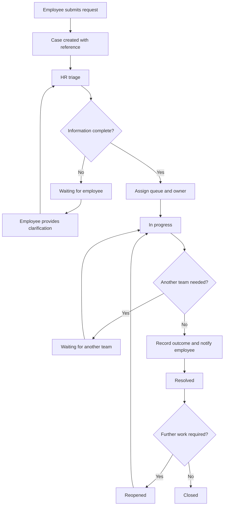

# HR Operations Hub — Process Model

## 1. End-to-end service flow

## 2. Case lifecycle and ownership

| State | Meaning | Queue visibility | Employee visibility |
|---|---|---|---|
| Submitted | New request awaiting triage | New | Received |
| In review | HR is checking scope and completeness | Open | Under review |
| In progress | An owner is processing the case | Open | In progress |
| Waiting for employee | Employee clarification is needed | Waiting | Action needed from you |
| Waiting for another team | Another internal team must act | Waiting / hand-off | In progress; another team is involved |
| Resolved | Outcome recorded and communicated | Resolved | Resolved |
| Closed | No further action expected | Closed | Closed |
| Reopened | Further work required after resolution | Open | Reopened |

A waiting state is not a terminal state. It remains part of the operational workload.

## 3. Triage model

Each request should be checked for:

1. **Category and topic** — is it in the service catalogue?
2. **Completeness** — does HR have the minimum information to understand the request?
3. **Routing** — which queue is responsible for the next action?
4. **Ownership** — who is accountable for moving the case forward?
5. **Priority** — how should the request be ordered against other work?
6. **Service target** — what illustrative target applies, and when does it expire?
7. **Communication** — does the employee need an acknowledgement, clarification or progress update?

The prototype can suggest a queue based on the selected category. HR must be able to review and change the routing. This is deterministic mapping, not AI classification.

## 4. Queue responsibility map

| Queue | Typical scope | Example hand-off |
|---|---|---|
| HR Operations | Employment documents, personal data changes, routine administration | Payroll / Benefits / HR Systems |
| Payroll | Payslip questions and payroll data corrections | HR Operations for employee lifecycle data |
| Benefits | Benefits and insurance administration | HR Operations for general employee records |
| HR Systems | Employee self-service and HR portal access | HR Operations if the request is not a system issue |
| People Support | Policy and general HR questions | Specialist team where required |

This is an illustrative operating model. Actual responsibilities differ between organisations.

## 5. Communication model

There are two different communication channels on a case:

### Employee-visible updates

Used for acknowledgements, clarification requests, progress updates and resolution summaries. They should use clear language and state the next step.

### Internal HR notes

Used for handover context, internal coordination and processing reminders. They must be visually separated from employee-visible messages and must never appear on the employee-facing case view.

The prototype may simulate these audiences, but it must not claim that the simulated view switch provides security or role-based access.

## 6. Illustrative service-target model

Targets are examples for demonstrating the mechanics only. They are not company policy and not legal deadlines.

| Priority | Example first response target | Example resolution target |
|---|---:|---:|
| Urgent | 4 business hours | 1 business day |
| Important | 1 business day | 3 business days |
| Standard | 2 business days | 5 business days |

Use due dates in seeded cases to demonstrate within-target, approaching-target and overdue states. Clearly identify that the prototype uses simplified business-time assumptions. If the implementation uses calendar hours rather than business hours, label the calculation accordingly.

## 7. Operational reporting definitions

| Metric | Definition | Interpretation caveat |
|---|---|---|
| Incoming requests | Count of requests created in the selected period | Count, not a measure of complexity |
| Open backlog | Count of cases not in Resolved or Closed state | Includes cases waiting for employees or other teams |
| Unassigned cases | Open cases without an accountable owner | A routing/ownership signal |
| Overdue cases | Open cases whose illustrative target due date has passed | Must disclose the date and target logic |
| Median resolution time | Median elapsed time from submission to resolution for resolved cases in the selected period | Excludes open cases; not a productivity score |
| Reopened rate | Reopened cases divided by resolved cases in the selected period, using one documented cohort definition | Small counts can create volatile percentages |
| Waiting for employee | Count of open cases in the employee-waiting state | May be outside HR's immediate control |
| Waiting for another team | Count of open cases in the cross-team waiting state | Indicates dependency and hand-off work |

No composite score should combine these metrics. Each chart and KPI must display its denominator, date range and definition.

## 8. Process-improvement questions

The insights surface should help HR Operations investigate:

- Which request categories generate the most demand?
- Which queues hold the largest share of the open backlog?
- How many cases are waiting for the employee versus another team?
- Which case types tend to exceed the illustrative service target?
- How frequently are resolved cases reopened?
- Are unassigned cases accumulating?

The dashboard should show signals, not automatically assign blame to individual employees or teams.
