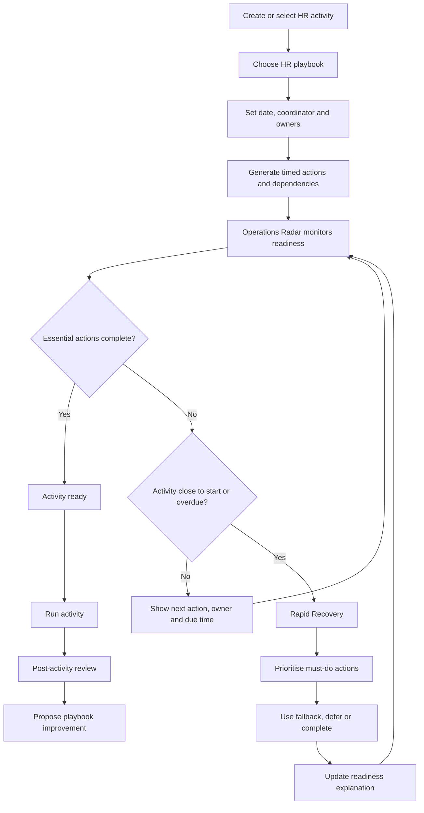

# HR Operations Hub — Process Model

## 1. Core operating loop

## 2. Activity lifecycle

| State | Meaning | What the HR Generalist sees |
|---|---|---|
| Planned | Activity created; preparation has not begun | Start date and upcoming actions |
| Preparing | Actions are being completed | Next action, owner and lead time |
| Needs attention | Essential action incomplete or ownership missing | Exact gap and suggested next step |
| At risk | Essential action overdue, blocked or waiting too close to start | Blocker, responsible role and consequence |
| Recovery | Activity is inside the short recovery window with unresolved essentials | Must-do-now sequence and fallbacks |
| Ready | Essential pre-start actions complete; no active blocker | Readiness explanation |
| Completed | Activity has taken place | Post-activity review |
| Cancelled | Activity will not take place | Cancellation reason |

Readiness is derived from action states and due times; it is not a manually assigned score.

## 3. Playbook model

A playbook is a reusable operational recipe. Each playbook contains:

| Field | Meaning |
|---|---|
| Activity type | Training, information session, cycle launch, recurring deadline, communication |
| Action | One concrete operational step |
| Relative due offset | When the action should be completed relative to activity start |
| Owner role | HR, trainer, IT, Facilities, manager or another stakeholder |
| Criticality | Essential, Important or Optional |
| Estimated effort | Approximate effort for planning, not a measured duration |
| Dependencies | Prerequisite actions |
| Completion evidence | Simple note or completed state; no document upload |
| Fallback | A practical alternative if the planned action is no longer feasible |

A playbook must separate universal preparation steps from organisation-specific policy. All example timings are illustrative.

## 4. Example: Training session playbook

| Action | Suggested lead time | Owner role | Criticality | Depends on |
|---|---:|---|---|---|
| Confirm trainer and session content | 7 days | HR / Trainer | Essential | — |
| Confirm participant list | 5 days | HR | Essential | — |
| Reserve room or virtual meeting | 3 days | HR / Facilities | Essential | Session time confirmed |
| Confirm IT / presentation setup | 1 day | IT | Essential | Room / virtual format known |
| Send participant reminder | 1 day | HR | Important | Participant list |
| Prepare materials and attendance list | 1 day | HR / Trainer | Important | Content confirmed |
| Final room / access check | 45 minutes | HR / Facilities | Essential | Room / virtual meeting set |
| Record attendance and feedback | After session | HR | Optional | Session completed |

This template is an example for the prototype, not a universal standard.

## 5. Rapid Recovery logic

Rapid Recovery is activated when the activity is within its configured recovery window and one or more Essential actions remain unresolved.

It should not simply sort every action by overdue time. It should take into account:

1. Time remaining until the activity begins.
2. Essential vs Important vs Optional criticality.
3. Dependencies and blockers.
4. Whether the action is still feasible in the available time.
5. Whether a fallback exists.

Suggested groupings:

- **Must do now** — essential actions that can still be completed and are prerequisites for starting.
- **Can simplify** — actions where a reduced version is acceptable for the demonstration scenario.
- **Can follow up later** — actions that do not prevent the activity from starting safely or coherently.
- **Blocked / needs someone else** — actions requiring a named owner or external team; show the next contact action, not a fake automated escalation.

The HR Generalist remains responsible for the final decision. The system explains its suggested order and never silently marks work as complete.

## 6. Readiness rules

| Condition | State |
|---|---|
| All Essential pre-start actions complete; no active blockers | Ready |
| Essential action incomplete but not overdue | Needs attention |
| Essential action overdue or blocked | At risk |
| Recovery window reached and an Essential action unresolved | Recovery |
| Activity cancelled or completed | Cancelled / Completed |

The activity's next action should be selected from unresolved actions based on criticality, due time and dependency order. The calculation must be deterministic and tested.

## 7. Post-activity learning loop

After completion, the coordinator can record:

- which actions were completed as planned;
- which actions were late, simplified or skipped;
- which fallback was used;
- one short operational learning note;
- whether the playbook should be revised.

The prototype must not assign a performance rating to the coordinator or other stakeholders. Learning notes are about the process, not individual blame.

## 8. Operational insights

The MVP can display:
- upcoming activities by date and type;
- activities needing attention / at risk / in recovery;
- Essential actions currently overdue;
- recurring activities with missed or late actions;
- common playbook steps marked as blockers in synthetic demo history.

Every metric must state its data source and definition. Do not claim productivity gains or compare individual coordinators.
